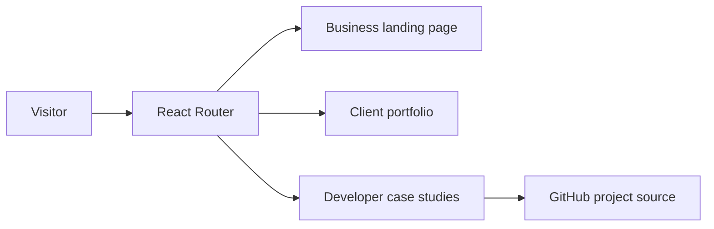

# Vertex Web Solutions

React business website with service explanations, a client-work portfolio, contact links, and a proposed developer portfolio at `/developer`.

## Source features and status

- Component-based service pages and responsive navigation.
- Client-work portfolio at `/portfolio`; entries are existing source claims, not independently verified client outcomes.
- Developer case studies at `/developer` explain the CRM, alert automation prototype, and this website, linking to their source and identifying verification limits.
- The service selector is an **illustrative walkthrough**, not a connected AI receptionist or an LLM integration.
- Phone/email links are contact actions; no résumé download is linked until its facts are confirmed.

The supplied business URL is https://vertexwebsolutions.co/. This PR does not deploy changes or establish that hosted code matches this checkout.

## Architecture



`frontend/src/App.js` defines routes. `frontend/src/components/` holds presentation and navigation. Tailwind styles and shared CSS define the visual system. `backend/server.py` is a separate FastAPI/MongoDB status-check scaffold; the reviewed presentation components do not require it. Its status endpoints are unauthenticated and should not be treated as a production data API.

## Local development and checks

Node.js and npm are required for the commands below. The project also contains legacy Yarn metadata; use the committed npm lockfile for the reviewed npm dependency tree.

```bash
cd frontend
npm ci --legacy-peer-deps --ignore-scripts
npm start
```

```bash
CI=true npm run build
CI=true npm test -- --watchAll=false --passWithNoTests
```

There are currently no frontend test files; an exit code of zero with `--passWithNoTests` does not mean component behavior was tested. Build output goes to `frontend/build`. The direct AJV development dependency resolves the reviewed npm build's schema-validator resolution failure. `--ignore-scripts` skips dependency lifecycle scripts; it is not a general sandbox.

For a local portfolio demonstration, open `/developer` after starting the frontend. This page uses no customer data or backend. It links to external source repositories; mail links open the visitor's email client. Do not submit forms, place calls, or contact clients during automated QA.

## Review priorities

- Replace or remove placeholder testimonials before treating them as customer evidence. The existing source explicitly identifies them as placeholders.
- Confirm client-work claims, dates, and permission for screenshots before expanding case studies.
- Add route-specific canonical and social metadata; the static HTML currently supplies homepage metadata for all routes.
- Measure mobile layout, keyboard navigation, contrast, loading behavior, and performance on the actual host before claiming scores.
- Plan dependency upgrades and a reproducible supported toolchain; React Scripts 5 and the current peer-dependency mix need maintenance.
- Keep `.env`, API credentials, and production/customer data out of source and demonstrations.

No conversion metrics, testimonials, or performance improvements are claimed by this documentation.
